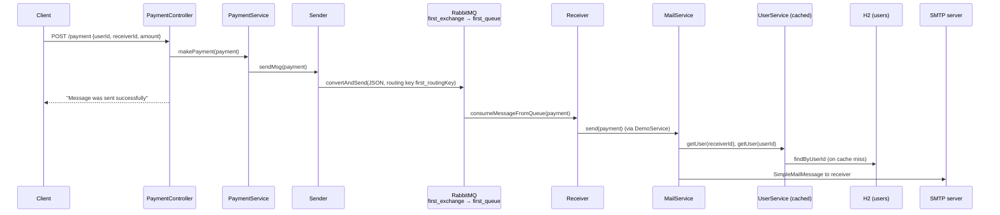

# demo.fortech

A Spring Boot demo application that shows an **asynchronous payment-notification flow**. A client submits a payment over REST, the payment is published to **RabbitMQ**, and a message listener consumes it and sends an **email** to the receiving user. User records live in an embedded **H2** database and are cached with Spring's cache abstraction.

The project is a learning/demo sample rather than a production payment system: no money moves and no payment is persisted. The "payment" is only a message that triggers a notification email.

---

## Table of contents

- [Features](#features)
- [Architecture](#architecture)
- [Tech stack](#tech-stack)
- [Project structure](#project-structure)
- [Prerequisites](#prerequisites)
- [Configuration](#configuration)
- [Running locally](#running-locally)
- [API](#api)
- [Database](#database)
- [Testing](#testing)
- [Docker](#docker)
- [Known limitations](#known-limitations)
- [Security notes](#security-notes)
- [Further reading](#further-reading)

---

## Features

- **REST endpoint** `POST /payment` that accepts a payment (`userId`, `receiverId`, `amount`).
- **RabbitMQ messaging**: payments are serialized to JSON and published to a topic exchange, then consumed from a queue by a `@RabbitListener`.
- **Email notifications** through Spring's `JavaMailSender` (configured for Gmail SMTP with STARTTLS).
- **JPA persistence** of users in a file-based H2 database, with the H2 web console enabled.
- **Caching** of user lookups via `@Cacheable` / `@EnableCaching`.
- **Seed data**: two users are inserted at startup.

## Architecture



The HTTP response is returned as soon as the message is published. Email delivery happens later, on the listener thread.

### Components

All classes live under `com.example.demo.fortech`.

| Package | Class | Responsibility |
|---|---|---|
| *(root)* | `Application` | Spring Boot entry point; enables caching (`@EnableCaching`). |
| `payment` | `PaymentController` | REST controller mapped to `/payment`. |
| `payment` | `PaymentService` | Hands the payment to the RabbitMQ sender and logs it. |
| `payment` | `Payment` | Message DTO: `userId` (Integer), `receiverId` (Integer), `amount` (Double). |
| `rabbitmq` | `Sender` | Publishes a `Payment` to `first_exchange` with routing key `first_routingKey` using a JSON converter. |
| `rabbitmq` | `Receiver` | `@RabbitListener` on `first_queue`; forwards each payment to `DemoService`. |
| `configuration` | `RabbitMqConfig` | Declares the queue `first_queue`, topic exchange `first_exchange`, their binding, and a `Jackson2JsonMessageConverter`. |
| `configuration` | `StartUp` | On `ContextRefreshedEvent`, saves the two seed users. |
| `mail` | `DemoService` | Thin wrapper that delegates to `MailService`. |
| `mail` | `MailService` | Loads sender and receiver users and sends the notification email. |
| `user` | `User` | JPA entity mapped to table `users` (`user_id`, `name`, `mail`). |
| `user` | `UserRepository` | Spring Data JPA repository with `findByUserId`. |
| `user` | `UserService` | `getUser(userId)`, cached in the `user` cache. |

## Tech stack

Versions come from `pom.xml`.

| Area | Technology |
|---|---|
| Language | Java 11 |
| Framework | Spring Boot 2.4.4 (`spring-boot-starter-parent`) |
| Web | `spring-boot-starter-web` |
| Messaging | `spring-boot-starter-amqp`, `spring-rabbit` 2.3.6 (RabbitMQ) |
| Mail | `spring-boot-starter-mail` |
| Persistence | `spring-boot-starter-data-jpa`, `jakarta.persistence-api` 2.2.3, H2 (runtime) |
| Caching | `spring-boot-starter-cache` (default in-memory cache) |
| Boilerplate | Lombok |
| Testing | `spring-boot-starter-test` (JUnit 5), `spring-rabbit-test` |
| Build | Maven, `spring-boot-maven-plugin` |

## Project structure

```
demo.fortech/
├── pom.xml                         # Maven build and dependencies
├── HELP.md                         # Spring Initializr reference links
├── Dockerfile                      # currently empty (see Docker)
├── mvnw, mvnw.cmd                  # Maven wrapper scripts (wrapper config missing, see below)
└── src/
    ├── main/
    │   ├── java/com/example/demo/fortech/
    │   │   ├── Application.java
    │   │   ├── configuration/      # RabbitMqConfig, StartUp
    │   │   ├── mail/               # DemoService, MailService
    │   │   ├── payment/            # Payment, PaymentController, PaymentService
    │   │   ├── rabbitmq/           # Sender, Receiver
    │   │   └── user/               # User, UserRepository, UserService
    │   └── resources/
    │       ├── application.properties
    │       └── data.sql
    └── test/java/com/example/demo/fortech/
        └── ApplicationTests.java
```

## Prerequisites

- **JDK 11** (JDK 11–15). The Lombok version managed by Spring Boot 2.4.4 (1.18.18) fails to compile on **JDK 16 and newer** with `IllegalAccessError: class lombok.javac.apt.LombokProcessor cannot access class com.sun.tools.javac.processing.JavacProcessingEnvironment`. If you only have a newer JDK, you can override Lombok for a build, e.g. `mvn test -Dlombok.version=1.18.30` (verified on JDK 21).
- **Maven 3.x** installed locally. The `mvnw` scripts are present, but the `.mvn/wrapper/` directory they need is not in the repository, so use `mvn` directly.
- **RabbitMQ** reachable from the application. For local development, one option is:
  ```bash
  docker run -d --name rabbitmq -p 5672:5672 -p 15672:15672 rabbitmq:3-management
  ```
- **An SMTP account.** The app is configured for Gmail (`smtp.gmail.com:587`). With Gmail you need an [App Password](https://support.google.com/accounts/answer/185833); your normal account password won't work.

## Configuration

Configuration lives in `src/main/resources/application.properties`.

### Environment variables

| Variable | Property | Description |
|---|---|---|
| `MAIL_USERNAME` | `spring.mail.username` | SMTP login, e.g. your Gmail address. |
| `MAIL_PASSWORD` | `spring.mail.password` | SMTP password / Gmail App Password. |

Both default to empty. The application still starts without them, but sending email will fail.

```bash
export MAIL_USERNAME="you@gmail.com"
```

```bash
export MAIL_PASSWORD="your-app-password"
```

### Other settings

| Property | Value | Notes |
|---|---|---|
| `spring.mail.host` / `spring.mail.port` | `smtp.gmail.com` / `587` | SMTP auth and STARTTLS enabled. |
| `spring.datasource.url` | `jdbc:h2:file:~/data;DB_CLOSE_ON_EXIT=FALSE;IGNORECASE=TRUE;MODE=MySQL` | File-based H2 database in your home directory. |
| `spring.datasource.username` / `password` | `sa` / `password` | H2 credentials. |
| `spring.h2.console.enabled` | `true` | H2 web console. |
| `spring.jpa.hibernate.ddl-auto` | `create` | Schema is dropped and re-created on every start. |

**RabbitMQ and HTTP port** are not set in `application.properties`, so Spring Boot defaults apply: RabbitMQ at `localhost:5672` with `guest` / `guest`, and HTTP on port `8080`. You can override them with standard Spring Boot properties or environment variables, for example:

```bash
export SPRING_RABBITMQ_HOST=my-rabbit-host
```

```bash
export SERVER_PORT=9090
```

> **Sender address:** `MailService` hard-codes the `From` header as `carpbianca98@yahoo.com`. Gmail typically rewrites or rejects a `From` that doesn't match the authenticated account, so change it in `MailService.java` to match your `MAIL_USERNAME`.

## Running locally

From the `demo.fortech/` directory, with RabbitMQ running and the mail variables set:

```bash
mvn spring-boot:run
```

Or build a jar and run it:

```bash
mvn clean package
```

```bash
java -jar target/demo.fortech-0.0.1-SNAPSHOT.jar
```

On startup the queue, exchange and binding are declared in RabbitMQ, and the seed users are written to H2.

## API

### `POST /payment`

Publishes a payment to RabbitMQ. The receiver then gets an email.

**Request body** (`application/json`):

| Field | Type | Description |
|---|---|---|
| `userId` | integer | ID of the sending user. |
| `receiverId` | integer | ID of the receiving user (the email recipient). |
| `amount` | number | Amount shown in the email. |

**Example:**

```bash
curl -X POST http://localhost:8080/payment -H "Content-Type: application/json" -d '{"userId": 2, "receiverId": 1, "amount": 50.0}'
```

**Response:** `200 OK` with the plain-text body:

```
Message was sent successfully
```

The response only confirms that the message was published. It doesn't confirm that the email was delivered.

**Resulting email** (sent to the receiver's `mail` address):

- Subject: `Demo`
- Body: `Hello <receiver name>! This is the e-mail received from my demo application. You received <amount> from <sender name>!`

### Seed users

Inserted by `configuration/StartUp` on each start:

| `user_id` | `name` | `mail` |
|---|---|---|
| 1 | Bianca Receiver | bianca.carp@fortech.ro |
| 2 | Bianca Sender | bianca.carp@fortech.ro |

To have emails delivered to you, change these addresses in `StartUp.java`. `src/main/resources/data.sql` also defines a `users` table and a seed row; `StartUp` upserts IDs 1 and 2 on every start.

## Database

- **Engine:** H2 in file mode (MySQL compatibility). Data is stored in `~/data.mv.db` in the home directory of the user running the app.
- **Schema:** generated by Hibernate from the `User` entity (`ddl-auto=create`), so it is reset on each start.
- **H2 console:** <http://localhost:8080/h2-console>
  - JDBC URL: `jdbc:h2:file:~/data`
  - User: `sa`
  - Password: `password`

## Testing

```bash
mvn test
```

The suite has a single test, `ApplicationTests.contextLoads`, a `@SpringBootTest` that checks the Spring context starts. It passes without a running RabbitMQ: the listener container logs `Broker not available ... Connection refused` and keeps retrying, but this doesn't fail the context. There are no unit or integration tests for the payment, messaging or mail logic yet.

## Docker

The repository has a `Dockerfile`, but it is **currently empty** and cannot be used to build an image. Until one is written, the Spring Boot Maven plugin can build an OCI image with Cloud Native Buildpacks (this needs a local Docker daemon):

```bash
mvn spring-boot:build-image
```

The container still needs RabbitMQ and the `MAIL_*` variables described above.

## Known limitations

- **Unknown user IDs:** `UserService.getUser` calls `Optional.get()` without a check. A payment with a non-existent `userId` or `receiverId` throws `NoSuchElementException` in the RabbitMQ listener, and no email is sent.
- **No input validation:** the `Payment` request body is not validated. Missing fields or negative amounts are accepted.
- **Nothing is persisted:** `PaymentService` logs `"Your payment … was completed successfully!"`, but payments are not stored anywhere.
- **Stale cache:** cached users are never evicted. Changes to a user in the database are not seen until restart.
- **Hard-coded `From` address** in `MailService` (see [Configuration](#configuration)).
- **Build artifacts are committed:** `target/` and the IntelliJ `demo.fortech.iml` file are tracked in Git. There is no `.gitignore`.
- **Maven wrapper is incomplete:** `.mvn/wrapper/` is missing, so `./mvnw` does not work.
- **JDK 16+ incompatibility:** the default Lombok version doesn't compile on JDK 16 or newer (see [Prerequisites](#prerequisites)).

## Security notes

- Never commit real SMTP credentials. Supply them with `MAIL_USERNAME` / `MAIL_PASSWORD`.
- An earlier commit of this repository contains a hard-coded Gmail App Password in `application.properties`. Removing it from the current file does not remove it from Git history, so **that App Password should be revoked** in the Google account settings.
- The H2 console is enabled with static credentials. Disable it (`spring.h2.console.enabled=false`) in any shared or deployed environment.
- `POST /payment` has no authentication. Anyone who can reach the service can trigger emails.

## Further reading

See [`HELP.md`](HELP.md) for Spring Initializr's reference links: Spring Boot Maven plugin, Spring Web, Spring for RabbitMQ, Java Mail Sender, Spring cache abstraction, and related guides.
